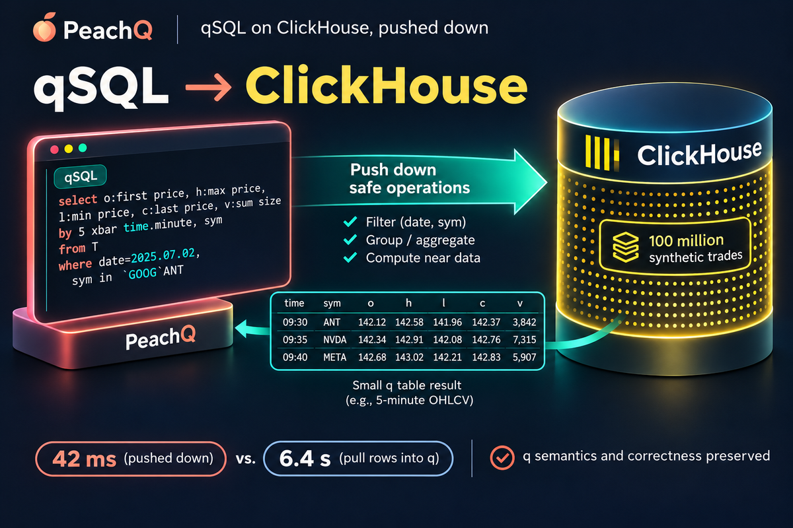

# qSQL on ClickHouse, pushed down

<!-- peachq: audience="You lead or work on a kdb+ team at a firm that also runs ClickHouse, and you know q and ClickHouse about equally well." goal="See that existing qSQL can run against ClickHouse tables with q's answers and ClickHouse's speed, and decide whether to pursue it for your own tables." -->

If your firm runs ClickHouse next to kdb+, moving more history into it is a
natural question. The awkward part is the q code: years of selects, analytics
and the people who wrote them. We built a prototype to test whether that code
can stay. A q developer writes ordinary qSQL against a ClickHouse table,
PeachQ turns it into ClickHouse SQL, ClickHouse does the work, and the answer
comes back as a q table. We then check it against the table q computes itself.



<!-- more -->

On 100 million trades, five-minute OHLCV bars for three symbols took 42 ms
pushed into ClickHouse, against 6.4 seconds pulling the day's rows into q.
The answers were equal.

<video class="peachq-video" controls preload="none" playsinline src="/video/2026-11-20-qsql-on-clickhouse-FHD.mp4" poster="/recordings/2026-11-20-qsql-on-clickhouse/intro-frame.png"></video>

The recording runs live on a shared development machine, so its timings
differ from the measured table below. With pushdown switched off, PeachQ
reads the columns for all five days before q filters them, which makes the
gap wider than in the table.

## What this means for a kdb+ team

- **The q stays.** Selects, `by` clauses, `xbar`, `wavg`, `first` and `last`
  are written as they are today. Nobody rewrites them as SQL.
- **The work runs where the data is.** ClickHouse filters, groups and
  aggregates; only the answer travels back to q.
- **The answer is q's.** Nulls, ordering and empty groups follow q's rules,
  not SQL's. Where ClickHouse cannot give q's answer, the query stays in q
  instead of returning something different.

## Point q at it

The test data is five days of synthetic trades, 20 million a day over 626
symbols, in a ClickHouse `MergeTree` sorted by `(sym, time, seq)` and
partitioned by date:

```sql
CREATE TABLE taq.trade (date Date, time DateTime64(9), sym LowCardinality(String), ex LowCardinality(String),
  cond LowCardinality(String), price Float64, size UInt32, seq Int64, tradeId Int64, corr Int32)
ENGINE = MergeTree PARTITION BY date ORDER BY (sym, time, seq)
```

Open the database and name the table:

```q
q)h:hopen (`:pq:clickhouse:taq; `url`database!("http://127.0.0.1:18123"; `taq))
q)T:`:pq:clickhouse:taq:trade/
q)meta T
| c       | t    | f      | a      |
| symbol  | char | symbol | symbol |
|=========|------|--------|--------|
| date    | d    |        |        |
| time    | p    |        |        |
| sym     | s    |        |        |
| ex      | s    |        |        |
| cond    | s    |        |        |
| price   | f    |        |        |
| size    | j    |        |        |
| seq     | j    |        |        |
| tradeId | j    |        |        |
| corr    | i    |        |        |
```

Our server listens on port 18123; ClickHouse's default HTTP port is 8123.
Each ClickHouse type reads as one q type:

| ClickHouse | q |
|---|---|
| `LowCardinality(String)` | symbol |
| `String` | string |
| `DateTime64(9)` | timestamp (UTC) |
| `Date` | date |
| `Float64` | float |
| `Int64` | long |
| `Int32` | int |
| `UInt32` | long |

`Nullable` versions map the same way, and NULL becomes the q null. The
prototype hides columns of other types rather than failing on them.

## OHLCV bars

```q
q)select o:first price, h:max price, l:min price, c:last price, v:sum size by 5 xbar time.minute, sym from T where date=2025.07.02, sym in `BAA`BAB`BAC
| minute | sym    | o      | h      | l      | c      | v    |
| minute | symbol | float  | float  | float  | float  | long |
|========|========|--------|--------|--------|--------|------|
| 04:00  | BAA    | 142.62 | 142.77 | 142.59 | 142.59 | 5542 |
| 04:00  | BAB    | 141.76 | 141.96 | 141.76 | 141.87 | 4916 |
| 04:00  | BAC    | 60.13  | 60.32  | 60.13  | 60.25  | 5163 |
..
```

All of it runs in ClickHouse. `.clickhouse.lastsql` holds the statement
PeachQ sent. Here it is with the column definitions trimmed:

```sql
WITH _q_src AS (…)
SELECT CAST(_q_min_time - (_q_min_time % 5 + 5) % 5 AS BIGINT) AS minute, sym,
       if(isNaN(argMin(_q_raw_price, _q_i1)), NULL, argMin(_q_raw_price, _q_i1)) AS o,
       coalesce(max(price), -inf) AS h, coalesce(min(price), inf) AS l,
       if(isNaN(argMax(_q_raw_price, _q_i1)), NULL, argMax(_q_raw_price, _q_i1)) AS c,
       CAST(coalesce(sum(size), 0) AS BIGINT) AS v
FROM _q_src WHERE _q_raw_date = toDate32('2025-07-02') AND _q_raw_sym IN ('BAA', 'BAB', 'BAC')
GROUP BY … ORDER BY …
```

Most of that SQL is there so the answer matches q's:

- **`first` and `last` follow the table's order.** In q, `first price` is
  the first row in table order. A ClickHouse table's order is its sorting
  key, so within one symbol's group the first row is the smallest
  `(time, seq)`, found with `argMin`.
- **Empty groups give q's identities.** `max` of no prices is `-0w` in q,
  hence `coalesce(…, -inf)`.
- **The filter is on the stored columns.** That lets ClickHouse prune by its
  primary key: this query reads 9 of the table's 12,210 granules.
- **The bucket is q's.** `5 xbar time.minute` comes back as q minutes, not as
  ClickHouse `DateTime` values.

`.clickhouse.sql[h; query]` returns the SQL for a select without running it,
so a developer can check what a query will send before it runs.

## Nulls follow q

```q
q)select time, price from T where date=2025.07.02, sym=`BAA, price<142.6
```

```sql
… WHERE _q_raw_date = toDate32('2025-07-02') AND _q_raw_sym = 'BAA'
    AND (_q_raw_price < 142.6 OR (_q_raw_price IS NULL OR isNaN(_q_raw_price))) ORDER BY i
```

In q a null is below every number, so `price<142.6` keeps a null price.
SQL's `<` drops NULL, so the extra arm puts those rows back.

## VWAP and the last ten trades

```q
q)select vwap:size wavg price, v:sum size by sym from T where date=2025.07.02
```

```sql
SELECT sym, if(isNaN(sum(size * price) / sum(size * CAST(price IS NOT NULL AS INTEGER))), NULL,
       sum(size * price) / sum(size * CAST(price IS NOT NULL AS INTEGER))) AS vwap,
       CAST(coalesce(sum(size), 0) AS BIGINT) AS v
FROM _q_src WHERE _q_raw_date = toDate32('2025-07-02') GROUP BY sym ORDER BY sym
```

`wavg` is `sum(size * price)` over the sum of the weights, but only the
weights of non-null prices count, as in q.

```q
q)select[-10] time, price from T where date=2025.07.02, sym=`BAA
```

```sql
SELECT time, price FROM (SELECT time, price, i FROM _q_src
  WHERE _q_raw_date = toDate32('2025-07-02') AND _q_raw_sym = 'BAA' ORDER BY i DESC LIMIT 10) ORDER BY i
```

`select[-10]` means the last ten rows in table order. `i` is the sorting key
`(sym, time, seq)`: the inner query takes ten rows from the end and the
outer one puts them back in ascending order, as q returns them.

## When a query stays in q

Here is a table with no sorting key:

```sql
CREATE TABLE taq.tape (sym LowCardinality(String), price Float64) ENGINE = MergeTree ORDER BY tuple()
```

```q
q).clickhouse.sql[h; "select open:first price by sym from `:pq:clickhouse:taq:tape/"]
`stays_in_q
```

q's `first` needs a table order, and this table does not have one that
ClickHouse will guarantee. Rather than guess which row is first, PeachQ pulls
the two columns and q answers from the rows it reads.

## How fast

We ran each query three ways on the same machine:

- **Pull then q:** fetch the day's rows for the columns the query reads, then
  run the select in q.
- **Pushed:** the qSQL on the ClickHouse table.
- **Hand-written SQL:** the same question written directly in ClickHouse SQL,
  read back the same way.

Milliseconds, median of seven warm runs, on a shared 10-core machine with
ClickHouse 25.8 in Docker and its data in memory:

| query | pull then q | pushed | hand-written SQL |
|---|---:|---:|---:|
| 5-minute OHLCV bars, 3 symbols, one day | 6,358 | 42 | 27 |
| 5-minute OHLCV bars, all 626 symbols, one day | 10,467 | 785 | 731 |
| VWAP by symbol, all symbols, one day | 3,210 | 104 | 78 |
| count and high, one symbol, one day | 2,404 | 16 | 8 |
| last 10 trades of one symbol | 5,124 | 18 | 6 |

Every pushed answer equals the pull-then-q answer.

Pushing is 13 to 285 times faster than pulling into q. On the two large
queries it is within 1.07 and 1.34 times of hand-written SQL. On the small
ones the difference is a fixed cost of about 9 ms per select, for a schema
lookup and the translation, which schema caching would largely remove.

## A look at aj

Today an `aj` works on ClickHouse data in two steps. The select on the trade
table is pushed, so ClickHouse returns only one day of three symbols, and
`aj` runs in q on those rows:

```q
q)P:([] sym:`BAA`BAB`BAC; time:3#2025.07.02D10:00)
q)aj[`sym`time; P; select sym, time, price, size from T where date=2025.07.02, sym in `BAA`BAB`BAC]
| sym    | time                          | price  | size |
| symbol | timestamp                     | float  | long |
|--------|-------------------------------|--------|------|
| BAA    | 2025.07.02D10:00:00.000000000 | 142.6  | 49   |
| BAB    | 2025.07.02D10:00:00.000000000 | 141.84 | 461  |
| BAC    | 2025.07.02D10:00:00.000000000 | 60.24  | 59   |
```

The next step is pushing `aj` itself, which maps naturally onto ClickHouse's
`ASOF LEFT JOIN`. In a separate test of 30 probe times against three symbols,
a hand-written `ASOF LEFT JOIN` returned the same rows as PeachQ's `aj` on the
pulled trades, in 17 ms against 65 ms. That translation is not built yet.
PeachQ's own `aj` has not been checked against kdb+, and ties at equal times
and unmatched rows need care.

## What this is

This is a prototype on a development branch. It is not in a PeachQ release.
It is read-only, covers the column types above, and was tested on the
queries in this post and its own test suite. Every pushed shape is tested
against the same select run in q on pulled rows.

Turning it into something you would run against production tables needs:

- a reader for ClickHouse's Native format that streams results straight into
  q vectors (results currently travel as Parquet);
- the remaining ClickHouse types, such as `Decimal`, `Array`, `Map` and `Enum`;
- split filters, so a `where` term ClickHouse cannot answer exactly no
  longer forces a whole query back into q;
- joins beyond the `aj` preview, and schema caching for small queries;
- testing against your queries, on your tables.

If you run kdb+ next to ClickHouse and want this built out, [contact us](/contact).
Send the queries that matter to you, and we will tell you which of them push
today and what the rest would take.
